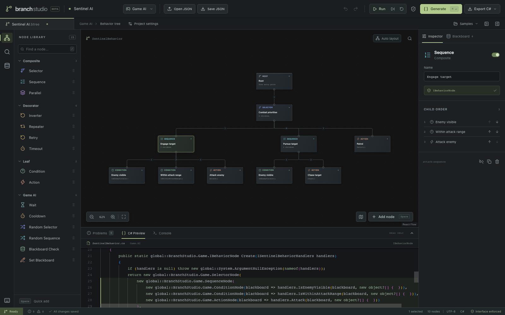

# Branch Studio

このディレクトリはMAUI HybridWebView用の独立したWebバンドルです。元のWebアプリの画面・操作を保ち、MAUI内ではOpen JSONをネイティブFilePicker、JSON / C# / ランタイムの保存をネイティブFileSaverへ渡します。通常のブラウザではファイル入力とダウンロードへフォールバックします。MAUIの通信APIはホストの存在を検出したときだけ読み込みます。

読み込むプロジェクトはUTF-8で5 MiB、2000ノード、深さ512までです。ネイティブ／ブラウザ／保存データの復元で同じ検証処理を使い、失敗やキャンセルでは編集中のデータを置き換えません。ネイティブ保存は20 MiBまでです。ブリッジの契約は `src/lib/native-files.ts` と `tests/desktop-files.test.ts` を参照してください。

ゲームAIと業務フローを組み立て、実装可能なC#のファクトリーを生成する、ブラウザ内で完結するビヘイビアツリーエディタです。Next.js App Router / TypeScript / React Flow / Zustand / Zod / Monaco Editorで実装しています。

[](https://branch-studio.vercel.app)

## 起動

Node.js 22.9以降とpnpm 10を使用します。

```sh
pnpm install
pnpm dev
```

http://localhost:3101 を開きます。初回は編集可能な敵AIのサンプルが表示されます。Monacoの配信ファイルは `predev` / `prebuild` で依存パッケージからコピーされ、外部CDNを使用しません。

```sh
pnpm build
pnpm start
```

`out/` に静的サイトを出力します。`pnpm start` はその成果物を配信するローカル確認用サーバーです。主要な機能にバックエンドやAPIキーは不要です。VercelではNext.jsプロジェクトとしてインポートし、`pnpm build` をビルドコマンドに指定できます。公開先は [branch-studio.vercel.app](https://branch-studio.vercel.app) です。

## アイコンと共有プレビュー

`public/favicon.svg` を原本として、ICO（16 / 32 / 48px）、Apple用180px、192 / 512pxのPNGを生成します。共有プレビューは1200×630px、READMEの画面画像は1600×1000pxです。

```sh
pnpm assets:icons
pnpm exec playwright install chromium
```

別のターミナルで `pnpm dev` を起動してから、次を実行します。

```sh
pnpm assets:preview
```

サンプルツリーを新しいブラウザコンテキストで撮影するため、編集中の保存データは使用しません。共有画像の配置は `scripts/social-preview.html` で編集できます。画面を撮り直さずに共有画像だけを更新する場合は `pnpm assets:preview --reuse-screenshot` を実行します。

生成した画像はリポジトリに含め、通常のビルドではブラウザを起動しません。公開ドメインを変更する場合は、`src/app/layout.tsx` の `metadataBase` と共有画像内のURLを更新してください。

## 編集

- ライブラリのクリック／ドラッグ、Spaceのクイック追加、右クリック、接続ハンドルからのドラッグでノードを追加。
- ハンドル同士をドラッグして接続。循環、複数親、自己接続、Rootへの入力、接続数の上限を拒否。
- Shiftで複数選択。選択したノードの複製、コピー、貼り付け、削除、Undo / Redo。
- ノードを選んでInspectorから名前、ハンドラー、引数、制御パラメーターを編集。子の実行順序は上下ボタンで変更。
- 座標と実行順序は独立。Auto layoutは配置だけを変更。
- ファイル名の近くにあるProject settingsから、プロジェクト名・名前空間・クラス名を編集。選択がないときもInspectorにプロジェクト設定を表示。
- Blackboard / Contextで型付き共有変数を定義。bool / int / float / string / Vector3に対応。Vector3は `[0, 0, 0]` のJSON配列。
- リアルタイム検証。Problemsから該当ノードへ移動。エラーがある間はC#のコピーとエクスポートを無効化。
- C#プレビューとノードの相互選択。ソースの行番号対応はメタデータで管理。
- Samplesから敵AI、注文処理、空のツリーを読み込み。読み込みもUndo可能。
- Game AI / Workflowを切り替えてもノードは保持。互換性のないノードをProblemsに表示し、対応するノードがある場合はInspectorで明示的に変換可能。

| 操作             | キー                       |
| ---------------- | -------------------------- |
| クイック追加     | Space                      |
| ライブラリ検索   | /                          |
| Fit view         | F                          |
| Undo / Redo      | Cmd/Ctrl + Z / Shift + Z   |
| Copy / Paste     | Cmd/Ctrl + C / V           |
| Duplicate        | Cmd/Ctrl + D               |
| Select all       | Cmd/Ctrl + A               |
| Save locally     | Cmd/Ctrl + S               |
| Generate         | Cmd/Ctrl + Enter           |
| Delete           | Delete / Backspace         |
| 複数選択         | Shift + クリック／ドラッグ |
| 選択ノードを移動 | 矢印キー                   |

複数選択はShift + クリック／ドラッグ、キャンバスの移動はスクロール／中央ボタンのドラッグです。操作の一覧は左下のKeyboard shortcutsから開けます。

フォームとMonacoへの入力中は、エディタ側のショートカットを実行しません。画面下の出力パネルは、境界のドラッグまたはフォーカスして上下キーでリサイズできます。

## 保存と出力

編集内容はLocalStorageへ自動保存し、同じブラウザで同じURLを開くと前回のプロジェクトを復元します。通常の再読み込みやタブを離れる際にも、保存待ちの変更を書き込みます。画面下の「All changes saved」で保存済みか確認できます。保存できない場合はステータスを表示します。ブラウザ間・端末間の自動同期はありません。

別のブラウザや端末で続きを編集する場合は、JSONファイルで引き継ぎます。

1. 編集元のブラウザで、上部の **Save JSON** を選び、`.json` ファイルをダウンロードします。
2. 別のブラウザでBranch Studioを開きます。
3. 上部の **Open JSON** から、そのファイルを読み込みます。

ノードの配置・接続・実行順序、パラメーター、Blackboard / Context、モード、コード生成設定をまとめて復元します。読み込んだプロジェクトは、そのブラウザでも自動保存されます。C#ファイルは生成結果なので、編集の再開にはJSONファイルを使用してください。

プロジェクトのファイル操作はOpen JSON / Save JSONにまとめています。C#の操作は上部のGenerateとExport C#にまとめ、Export C#からコピー・ソースのダウンロード・ランタイムのダウンロードを選べます。JSONの読み込み時はZodで検証し、不正なファイルを読み込んでも編集中のデータを保持します。保存データの復元に失敗した場合は、そのデータを自動的に上書きしません。明示的な保存または新しいプロジェクトの読み込みで保存を再開します。

## C#の契約

モード、ノード種別、実行状態、変数型、Validation severity、ノード定義は、リポジトリ直下の `src/BranchStudio.Contracts` を正本とします。`src/generated/contracts.generated.ts` はC#から生成したファイルであり、直接編集しません。新しいノード種別や共有enumを追加するときはC#を変更し、ルートで `pnpm generate` を実行します。`pnpm contracts:check` は生成物の更新漏れを検出します。

すべての実行ノードは、Game AIでは `IBehaviorNode`、Workflowでは `IWorkflowNode` を実装します。Composite / Decoratorもこれらのインターフェースで子を受け取り、生成するファクトリーもインターフェースを返します。

ユーザー側の処理は生成された `I{ClassName}Handlers` を実装します。ファクトリーの `Create(handlers)` に渡す仕組みなので、処理の実装漏れはC#コンパイラーが検出します。文字列によるメソッド探索、リフレクション、何もしない代替ハンドラーはありません。

- **Game AI:** C# 9 / .NET Standard 2.1。Unity固有APIには依存しません。時間は `IGameClock` で注入でき、Unityの時間に合わせられます。Unity Editorでの実行確認は未実施です。
- **Workflow:** C# 12 / .NET 8。async / await、CancellationToken、HTTP、Retry、Timeout、明示的な例外ハンドリングに対応。
- 引数はJSONのプリミティブ値の配列です。例: `["enemy", 3, true]`。ハンドラーには `IReadOnlyList<object?>` として渡り、数値はdoubleになります。
- HTTPの認証情報はエディタへ保存せず、環境変数の名前だけを設定します。実行時に生成先の環境からBearerトークンを取得します。

導入例、時間、再開、キャンセル、失敗と例外の扱いは [runtime/README.md](runtime/README.md) を参照してください。

## シミュレーション

上部のGenerateの左側にあるRun / Pause / Step / Resetで、ASTを独立したインタープリターで実行します。実行結果とTick数はConsoleに表示します。1ステップは仮想時間0.25秒です。ConditionやActionのMock resultをInspectorで設定します。Running中のモックを変更してから続きを実行できます。

C#、HTTP、外部サービスはブラウザで実行しません。WorkflowのDelayは実際の非同期待機を仮想時間のステップとして表現します。外部処理の例外・キャンセルはモック対象に含みません。シミュレーションはC#プロジェクト側の統合テストの代替にはなりません。

Sequence / SelectorはRunningの子を記憶します。Parallelは未完了の子を順に評価する方式で、スレッドの並列処理ではありません。Repeater / Retryは回数に上限があり、1 Tickあたりの処理を制限します。無効化したノードは子孫を実行せずSuccessを返します。

## 構成

```text
src/lib/types.ts       UIに依存しないGraph / AST / 設定の型
src/generated/         C#から生成するTypeScript / JSON / standalone C#契約
src/lib/registry.ts    生成されたノード定義をEditor用に変換するadapter
src/lib/graph.ts       JSONスキーマ、接続制約、Graph → AST、配置
src/lib/validation.ts  構造・識別子・パラメーター・共有変数の検証
src/lib/store.ts       編集操作、選択、履歴、コピー
src/lib/generator.ts   AST → C#の純粋関数と行番号マッピング
src/lib/simulator.ts   AST専用の状態付きインタープリター
src/components/       React Flowへの変換、Inspector、Monaco、画面操作
runtime/              C#のゲーム用／Workflow用ランタイムとテスト
public/runtime/       共通契約を同梱したダウンロード用ランタイム
```

React FlowのノードやエッジをC#ジェネレーターに直接渡しません。Graphの明示的な接続順序を検証してASTを作り、生成処理へ渡します。

## 検証

```sh
pnpm typecheck
pnpm test
pnpm exec playwright install chromium
pnpm test:e2e
pnpm test:runtime
pnpm build
```

.NET SDK 8が必要なC#コンパイルテストは、SDKが見つからない場合はskipします。別の場所にSDKを用意した場合は `DOTNET_PATH=/path/to/dotnet pnpm test` で指定できます。Gameの生成コードはC# 9 / netstandard2.1、WorkflowはC# 12 / net8.0で実際にコンパイルします。

Vitestは接続制約、順序、Undo/Redo、保存・復元、バリデーション、決定的な生成、シミュレーターを検証します。Playwrightは実際の画面で編集、接続、保存・復元、モード切り替え、コードのダウンロードなどを検証します。C#のxUnitテストではRunningの再開、Retry、Timeout、キャンセル、型付き変数を確認します。
